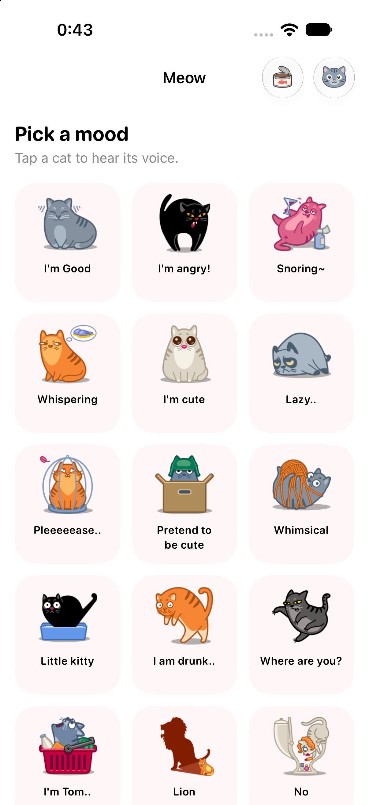
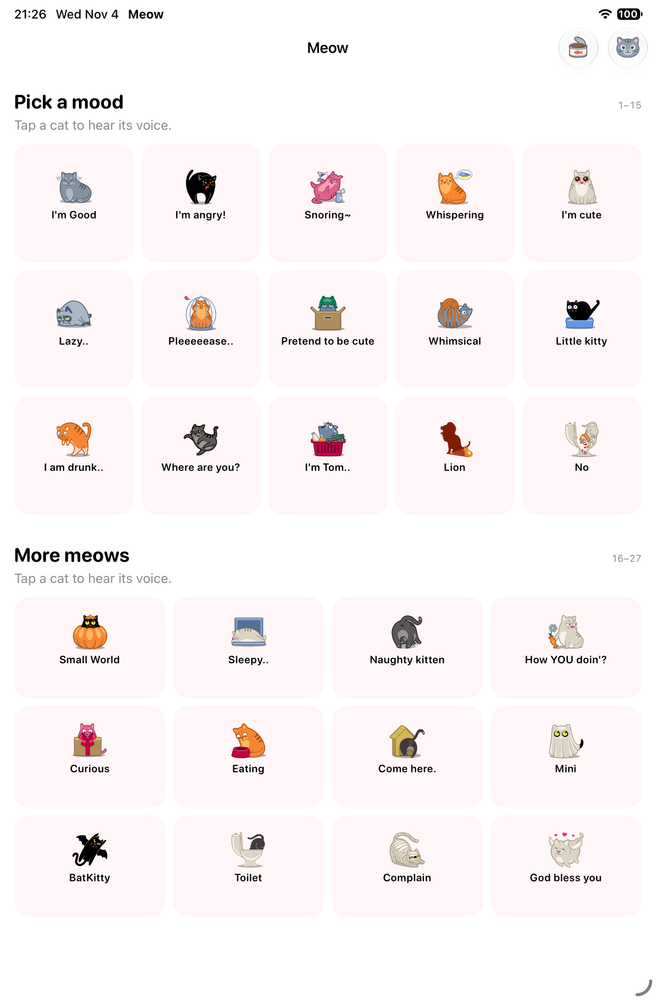

# iPhone Duo soundboard

## Design

Keep the one-tap soundboard on a compact display. Use the extra space on a
regular-width display for a cat spotlight, with the sound grid beside it or
below it. The original 27 cats, sounds, coral accent, and pink and yellow
surfaces remain the visual identity.

| Available space | Presentation |
| --- | --- |
| Compact width or compact height | Scrollable sound grid with a selected-sound replay control |
| Regular width and height, wide | Cat spotlight on the leading side; grid and replay on the trailing side |
| Regular width and height, tall | Cat spotlight above; grid and replay below |
| Active fold on iOS 27.1+ | System split arrangement assigns each pane a region outside the fold |
| Accessibility text sizes | Scaled grid columns, wrapping labels, and replay inside the scroll view |

The spotlight shows the **selected** sound. It does not claim that a short
clip is still playing after playback ends. Tapping any cat plays it
immediately; replay is also available on the compact display. The spotlight
has no separate action, so the upper pane stays passive in tabletop use.

`SoundboardView` owns the selection and visible item ID above its layout
branches. The audio player remains in `Sounds.shared`. Layout changes do not
start or stop audio. On iOS 17+, `scrollPosition` tracks stable cat IDs;
temporary nil positions during layout replacement do not erase the anchor.
iOS 15 and 16 keep selection but do not track a grid scroll anchor.

## Implementation

- Use `NavigationStack` on iOS 16+ and retain a stack-style `NavigationView`
  on iOS 15. The deployment target stays at iOS 15.
- Use `ArrangementView` with the split style on iOS 27.1+. The primary pane
  is the passive spotlight; the secondary pane has the grid and replay.
  The arrangement is only used with regular width and noncompact height.
  Earlier systems choose horizontal or vertical stacks from current view
  bounds. No device model, screen size, or hinge angle drives layout.
- Replace the old manually chunked rows with `LazyVGrid`, scaled minimum
  cell widths, stable IDs, and selection traits for VoiceOver.
- Keep foreground content inside the safe area. Remove the bottom-edge
  override and the `UIRequiresFullScreen` restriction.
- Provide toolbar labels and images so the system can supply side controls
  and overflow representations. Keep the existing separate glass buttons.
- Keep share and support in system sheets. Add a standard close action to
  the support sheet, and allow purchase labels to wrap.
- Request inline adaptive ads at the gallery's actual width, with a 50-point
  maximum height. Wait 300 ms after width changes before requesting a new
  size. Consent and purchase checks still gate ad requests.
- Localize new labels in English, Simplified Chinese, and Japanese. Use
  existing artwork and adaptive colors; no new asset dependency is required.

The previous main screen used `NavigationView`, ignored the bottom safe
area, and expanded its custom grid across the whole display. Its banner was
fixed at 320 points. Those assumptions are replaced in `ContentView.swift`,
`SoundboardView.swift`, `Banner.swift`, and `Info.plist`.

## SDK and sources

Built with **Xcode 27.2 (27B52), iOS 27.2 SDK**. This is the 27.1+ SDK tier
that supports full-display layouts and system vertical bars on iPhone Duo.
The arrangement API was checked against the local SwiftUICore interface and
Apple's documentation. No minimum OS bump is needed for older devices.

Applied skills from
[iphone-duo-skills at c3fa17c](https://github.com/mirzaaghazadeh/iphone-duo-skills/tree/c3fa17c363ff555c16e44e3e94f16929fcab9646):
readiness, adaptive layout, vertical bars, dual-pane patterns, and design
review. The skill source is a design reference and is not a build dependency.

Primary references:

- [Designing for iPhone Duo](https://developer.apple.com/design/human-interface-guidelines/designing-for-iphone-duo)
- [ArrangementView](https://developer.apple.com/documentation/swiftui/arrangementview)
- [SplitArrangementViewStyle](https://developer.apple.com/documentation/swiftui/splitarrangementviewstyle)

## Validation on November 2, 2026

Passed:

- Debug simulator build, including the new XCTest UI test bundle.
- Unsigned Release device build.
- Property list and localization syntax checks, and `git diff --check`.
- Native launch and screenshot review on dedicated iOS 27.0 simulators:
  iPhone 18 Pro in English, iPhone 18 Pro in Japanese at the largest
  accessibility text size, iPad mini in English, and iPad mini in Chinese
  with dark appearance.

The screenshots below show the native app. The iPad captures exercise the
fallback stack layout on iOS 27.0. They are **not iPhone Duo pose captures**.
They show initial states; tap, playback, rotation, and scroll restoration
have not been verified through these captures.

| Compact, English | Regular, English |
| --- | --- |
|  |  |

| Japanese, largest accessibility size | Chinese, dark appearance |
| --- | --- |
|  |  |

### Execution limit

XCTest execution was attempted but could not start. Xcode reports installed
CoreSimulator **1171.7.0**, while it requires **1174.21.0**. It disables
simulator destinations even though the existing iOS 27.0 runtime can launch
the app through its installed `simctl`. Device Hub also timed out during
Computer Use connection attempts. A local Maestro attempt could not get
past simulator initialization. No UI test pass is claimed.

No iPhone Duo / iOS 27.1+ simulator runtime was installed during this work.
The native arrangement, vertical bar placement, and fold transitions are
compiled but need runtime validation before release. Live adaptive ad fill
also needs a device check; the screenshots use `-MeowNoAds`.

### Reproduction

```sh
xcodebuild build-for-testing \
  -project meow.xcodeproj -scheme meow \
  -destination 'generic/platform=iOS Simulator' \
  -derivedDataPath /tmp/meow-duo-build CODE_SIGNING_ALLOWED=NO

xcodebuild build \
  -project meow.xcodeproj -scheme meow -configuration Release \
  -destination 'generic/platform=iOS' \
  -derivedDataPath /tmp/meow-duo-build CODE_SIGNING_ALLOWED=NO
```

After the simulator components are updated, run the existing unit suite and
the four new UI regressions on an iPhone and an iPad:

```sh
xcodebuild test \
  -project meow.xcodeproj -scheme meow \
  -destination 'platform=iOS Simulator,id=<SIMULATOR_UDID>' \
  -parallel-testing-enabled NO \
  -only-testing:meowTests \
  -only-testing:meowUITests/SoundboardLayoutTests \
  -only-testing:meowUITests/TipSheetScreenshotTests
```

`SoundboardLayoutTests` checks selection and replay through rotation, the
last cat at large text sizes, scroll retention after rotation, and support
sheet dismissal with selection retained. These tests compile but have not
run in this environment.

### Interactive HTML review

Run the preview on macOS with Python 3:

```sh
python3 tool/serve_iphone_duo_preview.py --bind 127.0.0.1 --port 8801
```

Open `http://127.0.0.1:8801/`. To review from another device on a Tailnet,
set `--bind` to the host's Tailscale IP address. The server exports only the
preview, its required app assets, and the native screenshots to a temporary
directory. Restart it after source changes.

The HTML review supports closed, open, book, tabletop, and left/right split
layouts. It uses all 27 app images and audio files, the three native string
tables, and prices from the local StoreKit configuration. Language, appearance,
text size, and selection are preserved in the URL. Purchase and restore
buttons show preview feedback only.

The preview now defaults to a second design, `dual-grid`: the first 15 sounds
fill the leading pane, and the other 12 appear in the trailing pane. At standard
text size, open/book poses use three columns and five rows per pane. The trailing
pane's last row spans all three columns for an ad placeholder, aligned with the
leading pane's last row of cats. In tabletop, the leading pane uses five columns
and three rows; the trailing pane uses four columns and three rows, followed by
a 50 px ad row. All 27 cards and the ad slot fit without scrolling. The preview
does not request or display live ads.
Tapping the selected card replays its sound, so this layout omits the separate
replay strip. Both grids play audio through one player and keep one selection.
Large text retains scrolling and the replay strip. Closed and split windows
merge all 27 cards into one scrolling list. The design switch restores the original
`spotlight` option for comparison. The selected design is also stored in the
URL. This alternative is HTML-only until design review is complete.

Browser checks confirmed that all 27 cards, their labels, and the ad placeholder
stay within the panes without scrolling in open, book, and tabletop poses in
all three languages at standard text size. The ad row aligns with the last
cat row in open and book poses. The smallest card was 110 by 108 CSS pixels
in book pose and 121 by 89 in tabletop. Large text still allows scrolling
and replay. These measurements describe the HTML mockup, not native hit targets.

System bars, folds, window sizes, and large text are design approximations.
This page does not replace native device validation. Browser checks covered
selection across layouts, audio playback requests and replay, sheet dismissal,
and the last cat at large text on a 390 px viewport. No console errors or
horizontal page overflow were observed.

### Remaining device review

- [ ] Closed, open flat, book, and tabletop: verify pane placement, side
  controls, safe areas, and all 27 cat hit targets.
- [ ] Select and scroll near the last cat, then fold and unfold without
  restarting the app. Verify selection, scroll anchor, and uninterrupted
  audio. Repeat with the support and share sheets open.
- [ ] Split View on the left and right, plus pinned Picture-in-Picture:
  verify that cats, replay, prices, close, and restore remain reachable.
- [ ] Repeat with the largest accessibility text size, dark appearance,
  VoiceOver, and all three app languages.
- [ ] With consent enabled and Google test ads configured, resize repeatedly
  and check that the banner stays within its pane and loads after settling.
- [ ] Run on an iOS 15 device to check the legacy navigation and sheet path.
