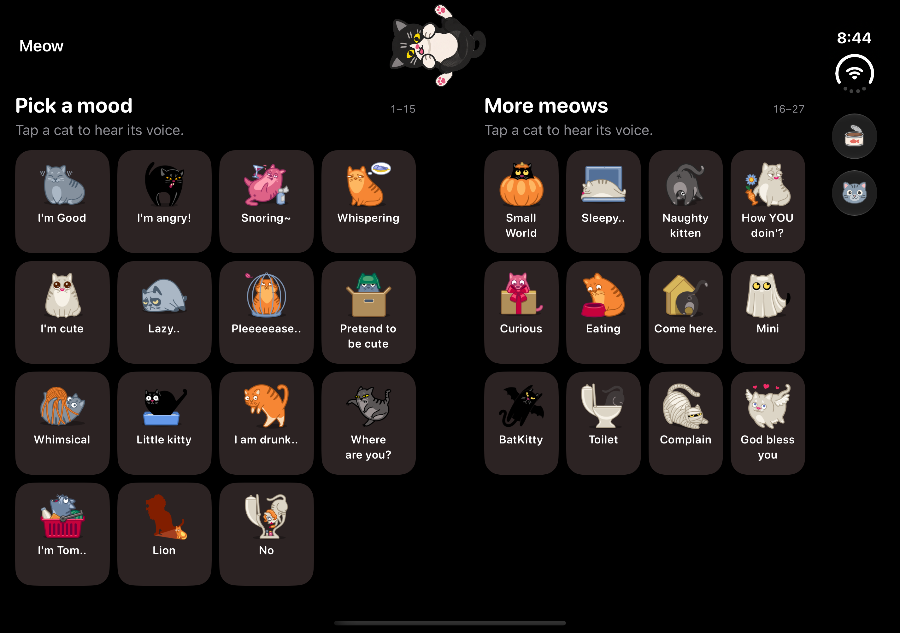
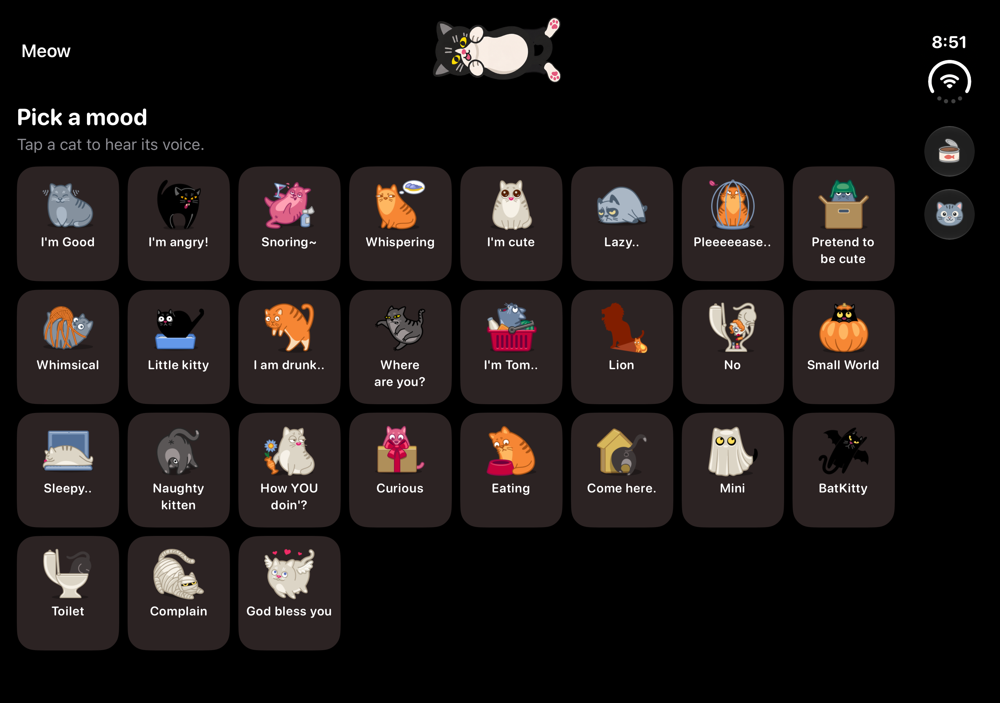
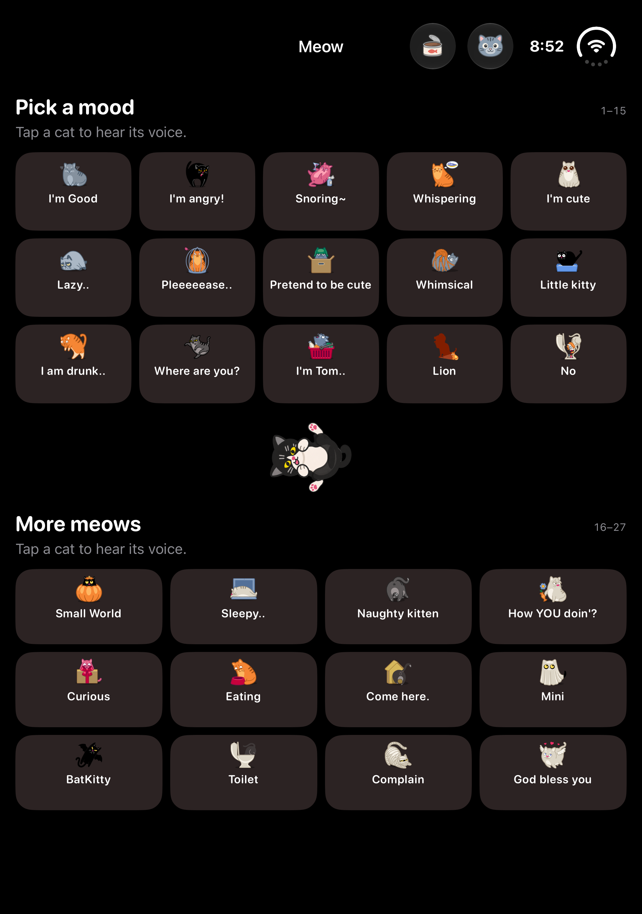
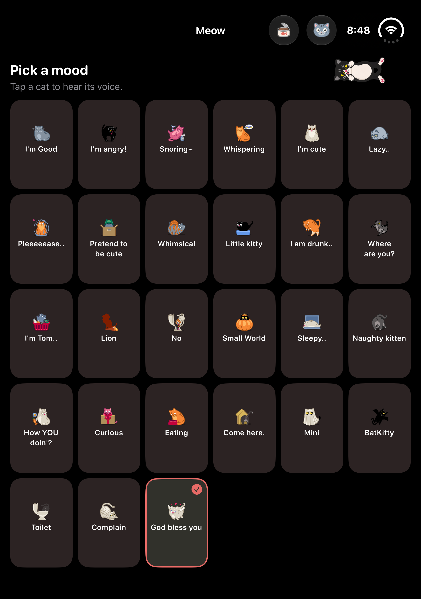

# Meow: three states and a cat that follows the fold

## Accepted direction

Keep the soundboard. Use three presentations: single screen, partially open
split, and fully open canvas. Add one small black-and-white tuxedo cat,
viewed directly from above as it lies on its back. Match the original cat
icons with simple flat fills and bold outlines. Its pose follows the hinge
continuously in both directions.
There is no separate play mode, timer, audio effect, or camera feature.

This document replaces the November 4 play concepts. The accepted design is
implemented in the native app for build 2.3 (8). The HTML remains the interactive
artwork reference; it does not read a hardware sensor.

| State | Layout | Decoration |
| --- | --- | --- |
| Single screen | One scrolling list of the existing 27 cats | Hidden |
| Partially open | 15 cats in one pane; 12 and the reserved ad row in the other | Lower body curls over the belly; hind legs spread beside the visible face; a small X marks the rump |
| Fully open | One heading and one continuous eight-column grid; the ad occupies the final five cells | Cat lies flat with its complete white belly visible; no center divider |

Standard text fits all 27 cats in both inner-display presentations at the
preview sizes. Large text keeps scrolling. The same selected cat and audio
owner survive every layout change.

## Motion

The cat sits near the fold in a small clear area. In a book or fully open
presentation it uses the top navigation space; in a tabletop presentation it uses space
between the panes. It is decorative, accepts no input, and covers no cat
button or ad. Interactive controls stay outside the fold region.

- Use the tuxedo coat pattern: black head, ears, back, flanks, and tail; white
  muzzle, chest, belly, and four paws with pink pads. Keep the belly white in
  dark mode. Use a fixed overhead camera; do not show the cat in side profile.
- At the initial half-open pose, curl the entire lower body toward the head
  like a shrimp. The black back of the rump covers the white belly and chest.
  Keep the hind legs spread in a wide V, with one rear paw on each side of
  the head. Leave the face and the two small front paws visible between them.
- Put a small light-gray X on the exposed rump as a cartoon privacy mark.
  Attach it to the lower body so it turns away with that body part.
- As the screen opens, unfold the lower body and lower both hind legs along
  curved paths around the hips. Turn the rounded rump away as a surface;
  do not slide or flatten it into a straight band. Reveal the white belly
  gradually. Keep the face and front
  paws fixed. Closing reverses the same motion. The initial pose must hide
  the belly, rather than only moving the legs above a flat torso.
- At full open, use short, tapered hind legs with rounded, fleshy thighs.
  The broad roots must continue naturally from the rump into narrower
  ankles. Keep the existing white paws and pads; avoid thin connecting stems.
- Stop moving the device and the pose stays still. Do not start a timed
  animation on a pose transition or add an idle loop.
- Hide the decoration on the outer single screen. Keep the fully open cat
  visible with its complete white belly.
- Under Reduce Motion, keep a static folded-leg pose within the partial state
  and show the static belly pose when fully open. At large
  accessibility text sizes, omit the decoration and keep the content readable.
- Folding alone does not play a sound. A cat button still plays its original
  sound without changing pitch or adding another voice.

## Native implementation boundary

Follow the user's three-state product model without deriving layout from a
stream of angle thresholds. Read active division regions and available space
for layout. Use the system hinge status to choose a partial or full decoration,
then map the continuous hinge angle to the pose. A nil hinge must clear the effect.
An iPad or ordinary iPhone still gets an appropriate single canvas or list.

Keep one selected sound and one audio owner above presentation changes.
Observe transitions only when the active region or available geometry changes;
angle-only updates must not rebuild or repartition the grid. Physical-device
testing must establish the comfortable motion range and any smoothing needed.
Do not assume a fixed angle range, update rate, or angle-derived state boundary.

`SoundboardView` reads division regions, including inactive regions. An active
region selects the system split arrangement. An inactive inner-display region
selects a continuous grid. Ordinary phones and iPads keep their existing layouts.
Each gallery tries a fitted layout before falling back to scrolling. Inner
landscape panes use four columns; a full landscape canvas uses eight. Portrait
uses five and four split columns, or six full-width columns. The ad keeps its
50 pt slot even when no ad is available.

`HingeCatView` owns the hinge observation and decorative state. It selects one
of 51 approved poses from a transparent image atlas. Angle-only updates change
the layer crop without repartitioning the soundboard. The observed fully open
angle calibrates the pose range; the initial estimate is pi radians. Missing
hinges clear the decoration. Reduce Motion uses the two static endpoints.
Observation stops when the scene is inactive. Physical-device tuning remains
necessary for the sensor range and update cadence.

## Geometry correction from the supplied screenshot

The user supplied a 2853 by 2007 pixel screenshot. At the simulator's 3x
rendering scale, this is the same 951 by 669 point inner canvas used by the
preview. The outer dimensions were correct; the usable content area was not.

On November 5, iOS 27.1 became available locally. Inspected the existing
2.3 (7) simulator build on a new iPhone Duo instance, in open and partially
open poses, at the standard and extra-small text settings:

- The landscape navigation area occupies about 86 pt above the soundboard.
  The previous HTML incorrectly started the soundboard at the top edge.
- The trailing system bar occupies 84 pt. The gallery therefore has about
  867 by 583 pt before its own padding and headings.
- The observed partial layout leaves approximately 40 pt around the physical
  center, including the region's margins. The older mock used 27 pt.
- The current native build scrolls and clips its bottom row in this viewport.
  The fitted five-row candidate requires more height than is available.
  Standard text shows three columns per pane; extra-small text shows four
  in the fully open pose, matching the supplied screenshot's column count.

The revised HTML includes that navigation area and observed fold clearance.
Book mode uses four columns and four rows per pane. The leading pane leaves
its final cell unused; the trailing pane reserves its fourth row for the ad.
Fully open uses eight columns and four rows. The cat uses top whitespace
instead of adding another row to the grid. These dimensions are preview
fixtures, not device constants to hardcode in the native layout.

Build 2.3 (8) replaces the overflowing five-row native candidate on Duo with
a four-row layout. Its minimum card width accounts for the asymmetric usable
space beside the system bar. The actual geometry selects a fitted candidate
or the scrolling fallback; no device dimensions are hardcoded.

## Preview

Run `python3 tool/serve_iphone_duo_preview.py` and open
`/?pose=book&fold=50`. Drag the opening slider or use the three state buttons.
The half-open direction selector also previews the horizontal fold. The
character detail dialog has a larger view and a second slider connected to
the same opening state.

The slider is a normalized design input. Its two endpoints simulate the
single and fully open states; interior values simulate the partially open
state. These are browser controls, not real hardware thresholds. Within the
partial state, only the decorative body and leg placement changes. There is no animation
clock, playback loop, or repeated grid layout.

## Artwork

Use the app's c02, c05, and c06 icons as style references: smooth dark outlines,
flat black and warm-white fills, yellow eyes, and simple pink paw pads. The
current artwork replaces the earlier soft fur rendering. Keep the camera
strictly overhead; the head is at the left and the rump is at the right.

The [base atlas](../../design/iphone-duo-assets/tuxedo-cat-rig-v2.png)
contains a body with two front paws and two separate hind legs. Its old
folded reference is superseded by the
[curled body sheet](../../design/iphone-duo-assets/tuxedo-cat-curled-v3.png):
the left cell shows the complete curl; the right cell isolates the lower
body. Both include the small rump X. The
[character reference](../../design/iphone-duo-assets/tuxedo-cat-flat-v2.png),
[base prompts](../../design/iphone-duo-assets/tuxedo-cat-rig-prompts.md), and
[curled body prompts](../../design/iphone-duo-assets/tuxedo-cat-curled-prompts.md)
are saved with them. The
[tapered thigh sheet](../../design/iphone-duo-assets/tuxedo-cat-thighs-v4.png)
and [thigh prompt](../../design/iphone-duo-assets/tuxedo-cat-thighs-prompts.md)
add two short black thighs without replacing the original white paws.
These were generated with the built-in image tool,
which did not expose a model version. Do not describe the output as version
2.6. The 1254 by 1254 base and thigh atlases and 1774 by 887 curled sheet
retain their original pixels and alpha.

The browser draws the atlas parts with Canvas 2D. Both hip anchors follow
the turning lower body. The rear paws move around them on curved paths and
settle closer to the rump at full open. The new thighs gain volume as the
legs unfold. The original paw portions keep their size, so the pads do not
stretch. The accepted first pose uses the original drawing unchanged.

The renderer reads the curled sprite's alpha contour once. Each horizontal
section projects onto a rounded surface that turns around the body's
cross-axis. Its far side becomes hidden, and the final thin edge fades as
it turns behind the underside. This replaces the previous flat width
compression and keeps the outer edge curved. The X follows the same surface.
The face and front paws stay above it, while a continuous base body prevents
gaps between the head and belly.

This is a layered 2D pose study. The complete curled pose is a static fallback
if Canvas 2D is unavailable or its context is lost. Reduce Motion holds the
folded pose until the fully open state. The Canvas renderer and detail dialog remain in the HTML preview. The native
app uses exported pixels from the same renderer, without a WebView or another
animation implementation.

To regenerate the native atlas, run the preview server and open
`/cat-atlas.html`. Export and download the transparent PNG, then replace
`meow/Assets.xcassets/hingeCatAtlas.imageset/hinge-cat-atlas.png`. The sheet has
eight columns and seven rows, with 480 by 288 pixel cells. Frames 0 through 50
sample opening values 0.50 through 1.00; the final five cells are empty.

## Validation

Checked the HTML in Chrome on November 5, 2026:

- Moving within the partial range changes the decorative pose without moving any cat button.
  Returning to an earlier input reproduces the same pose. Leaving the control still
  preserves its pose.
- A selected sound remains selected through partial, full, single, and
  tabletop presentations. Each presentation retains all 27 sound buttons.
- Full open has one visible gallery heading, eight columns, no fold, and a
  visible black-and-white cat with a white belly.
- Book, tabletop, and full-open layouts have no grid or label overflow in
  English, Simplified Chinese, or Japanese. The sample ad remains 50 px high.
- The decorative cat overlaps no sound button or ad in either split direction.
- Emulated Reduce Motion keeps a static decorative pose as the slider moves.
  Large text hides the decoration and allows scrolling.
- Hiding the sample ad preserves its slot. A 390 px browser viewport has no
  horizontal page overflow and keeps the opening slider reachable.

Checked the rounded roll and tapered-leg revision locally on November 6, 2026:

- The 50 percent artwork pixels match the accepted curled frame from
  `bfbbd4b` exactly. The face, four paws, hidden belly, and rump X are preserved.
- Inspected the intermediate poses at 60, 70, 75, and 80, then the fully
  open pose. The rump turns away with a curved edge, and the legs move around
  the hips. Full open has short, broad-rooted thighs that taper into the
  original white paws.
- A 50 to 100 to 50 sequence restores the exact initial artwork pixels.
  Reduce Motion keeps those same pixels when the input moves from 50 to 75.
- All 27 cards fit in book, tabletop, and fully open layouts. The ad remains
  50 px high, with no decoration overlap on headings, cards, or the ad.
  Button positions do not change between partial-state inputs.
- A local renderer check covers 101 inputs, curved limb paths, sprite and
  contour source bounds, thigh introduction after the initial pose, context
  loss and restoration, image failure, and unavailable drawing context.
- The served renderer, HTML, and new atlas match the source files.
  JavaScript syntax and whitespace checks pass. Chrome reports no warnings
  or errors. No GitHub Actions run was used.

Checked the native implementation locally on November 6, 2026:

- All 16 unit tests pass on iOS 27.0: five hinge tests, five Store tests, and
  six Widget/audio tests. The hinge checks cover calibration, reverse movement,
  absent and closed contexts, invalid angles, Reduce Motion, and the bundled
  atlas resolution.
- Four applicable soundboard UI regressions pass on each of iPhone 17e and
  iPad mini, iOS 27.0. Each device skips one inapplicable case. These cover
  selection, replay, rotation, large text, support sheets, scroll retention,
  and fitted iPad rows.
- The Duo UI check passes in book, tabletop, full portrait, and full landscape
  states on iOS 27.1. All 27 buttons are hittable and inside the window, and
  the final button can be selected and replayed without scrolling.
- Manual fold transitions retain the selected sound and the decorative view.
  The cat remains visible after switching from split to full; the full portrait
  pose uses heading whitespace to avoid the centered navigation title.
- Checked the system Reduce Motion switch: partial holds the accepted curled
  frame, full shows the white belly, and the closed outer screen hides the cat.
  Restored the simulator setting after the check.
- The first Duo Store test was stopped at a simulator account prompt. The
  prompt was cancelled, without signing in. All purchase tests then passed
  against the local StoreKit configuration on iOS 27.0.
- The Release archive passes signature checks. App and widget versions are
  2.3 (8); minimum OS versions remain 15 and 17. Both dSYMs are present.
- Tests and builds ran locally. No GitHub Actions workflow was dispatched.

The simulator verifies API wiring and layout. Physical sensor feel and live
ad fill still require device testing. Blank ad slots in the captures are
intentional: the UI checks launch with ads disabled.

## Build 2.3 (8)

The signed IPA was uploaded with Apple's `altool` on November 6, 2026.
Delivery ID: `9d1be1ab-f3a8-4b11-816c-99ec0a3dece9`.
Native source commit: `4f1f3c77609c861e537c5152eecd9cd2f76e7d3c`.
The initial Xcode upload waited at SPI analysis for about 13 minutes and was
stopped before the IPA transfer. The same archive was exported locally; the
alternate upload completed with exit code 0 and an upload-success response.
App Store Connect reports `VALID`. The existing Internal group contains this
build and reports `IN_BETA_TESTING`. Test notes are saved in English, Simplified
Chinese, and Japanese. No production version was submitted for review.

[Open TestFlight in App Store Connect](https://appstoreconnect.apple.com/apps/826362662/testflight/ios).

Local archive, exported IPA, test results, upload logs, and release provenance:
`/Users/jacky/Library/Developer/Meow/releases/2026-11-06-hinge/`.

## Native captures

| Partially open | Fully open |
| --- | --- |
|  |  |
|  |  |

## Sources

- [Hinge and scenes skill](https://github.com/mirzaaghazadeh/iphone-duo-skills/blob/c3fa17c363ff555c16e44e3e94f16929fcab9646/skills/iphone-duo-hinge-and-scenes/SKILL.md)
- [Adaptive layout skill](https://github.com/mirzaaghazadeh/iphone-duo-skills/blob/c3fa17c363ff555c16e44e3e94f16929fcab9646/skills/iphone-duo-adaptive-layout/SKILL.md)
- [DeviceHinge](https://developer.apple.com/documentation/swiftui/devicehinge)
- [ReservedRegion](https://developer.apple.com/documentation/swiftui/reservedregion)
